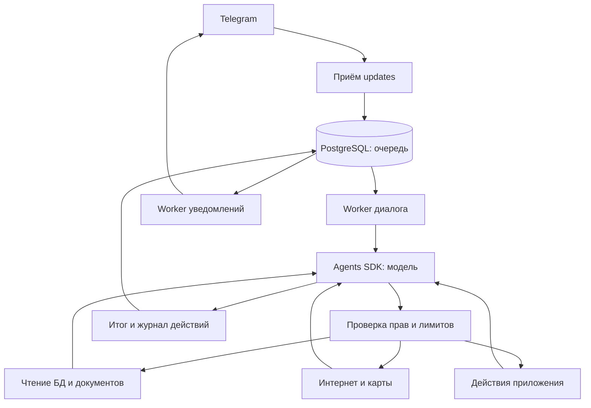

# Архитектура агента

## Состав решения

Приложение — модульный Django-монолит с несколькими процессами и общей PostgreSQL. Telegram остаётся единственным пользовательским интерфейсом. Модель работает через API; GPU и локальная модель на VPS не нужны.

Многошаговый harness построен на **OpenAI Agents SDK** (`openai-agents`). В установленном пакете 0.24.0 указана лицензия MIT. SDK выполняет цикл вызовов модели и инструментов внутри нашего Python-процесса; права, хранение данных и правила приложения определяет код проекта. Модель и внешние API подключаются отдельно и имеют собственные условия и стоимость.

`bot` принимает updates и сохраняет их до подтверждения получения Telegram. `worker_chat` обрабатывает диалоги. `worker_service` выполняет фоновые операции, повторы и Google-синхронизацию. `worker_notifications` отправляет ответы и напоминания. `scheduler` создаёт задания по расписанию. Опциональные Gunicorn/Caddy обслуживают OAuth callback и служебные HTTP endpoints, без пользовательского веб-интерфейса.

## Цикл одного запроса

1. Бот определяет пользователя, чат и доступные данные. Текст либо расшифрованное голосовое сообщение становится задачей агента.
2. `Agent` получает инструкцию, текущую дату/часовой пояс, ограниченный контекст диалога и каталог типизированных инструментов.
3. `Runner` вызывает модель. Она выбирает нужный инструмент и аргументы.
4. Приложение проверяет схему, права и лимиты. Инструмент возвращает данные или понятную ошибку.
5. Результат возвращается модели: она может уточнить поиск, прочитать найденный документ, запросить карту или выполнить разрешённое действие.
6. Цикл заканчивается итоговым ответом, необходимым уточнением пользователя или достижением лимита. Изменения и незавершённые шаги отражаются в результате.

Это агент на время запроса. Он не запускает произвольные новые цели в фоне. Напоминания, повторения, дневной план и Google-синхронизация по-прежнему работают отдельным детерминированным кодом и не требуют доступной LLM.

## Инструменты

| Группа | Возможности | Граница доступа |
|---|---|---|
| Записи БД | Поиск и чтение событий, задач, проектов и поездок с фильтрами и постраничной выдачей | Разрешённые модели и поля через Django ORM; произвольного SQL нет |
| Документы | Поиск по извлечённому тексту, чтение фрагментов оригинала, ссылки на документ и позицию | Только документы, доступные пользователю; общий родитель не открывает личный файл |
| Расписание | Поиск свободных окон, построение и принятие дневного плана | Учитываются участники, занятость и ограничения; перед записью выполняется повторная проверка |
| Интернет | Поиск и чтение публичных страниц, ссылки на источники и время получения | Ограниченный HTTP-контент, без браузерной сессии и входа на сайты |
| Карты | Поиск мест, расчёт маршрута и времени пути | Google Places API (New) и Routes API после настройки ключа |
| Действия | Создание и изменение объектов, завершение дел, чек-листы и операции поездок | Прикладные сервисы проверяют права, версии и правила согласования |
| Билеты | Получение сохранённого оригинала | Выдача через Telegram в разрешённый чат |

Инструменты БД выполняют актуальные запросы по мере необходимости. Поиск документов лексический: векторного индекса и embeddings нет. Поддержано чтение текстового слоя PDF и текстовых файлов TXT/MD/CSV/JSON; для изображений используются ранее распознанные сведения. Локальный предел — 200 страниц PDF и 1 млн символов документа, до 16 тыс. символов за один фрагмент; выдача содержит признак усечения и следующую позицию. Скан без текстового слоя требует настроенного распознавания; отсутствие распознанных данных не заменяется догадками модели.

Веб-чтение принимает HTML, обычный текст и PDF до 1 МиБ; возвращает до 20 тыс. символов и до первых 20 страниц внешнего PDF. Поиск в интернете выдаёт до 10 результатов. Google Maps поддерживает автомобиль, пеший путь, велосипед и общественный транспорт в пределах покрытия; для автомобиля запрашивается оценка с учётом трафика. Регистрация, получение багажа и другие пользовательские запасы добавляются отдельно.

Внешние источники возвращаются как недоверенные данные. Текст страницы или документа не выдаёт дополнительных прав, не меняет владельца записи и не расширяет набор инструментов. У агента нет shell, доступа к произвольным файлам сервера или произвольных операций от имени Google-пользователя.

Доступно 24 function tools:

- БД и документы: `search_records`, `read_record`, `search_documents`, `read_document`.
- Интернет и карты: `search_web`, `read_webpage`, `search_places`, `route_between`.
- Проекты и дела: `create_project`, `create_task`, `complete_task`.
- События и планирование: `create_event`, `update_event`, `available_slots`, `plan_day`, `accept_daily_plan`, `configure_recurrence`.
- Поездки: `create_trip`, `add_trip_segment`, `check_trip`.
- Чек-листы и билеты: `make_checklist`, `set_checklist_item`, `link_document`, `send_document`.

## Автономность и согласование

`AGENT_AUTONOMY=personal` — режим по умолчанию. Агент может выполнить разрешённые операции, связанные с запросом, без подтверждения каждого промежуточного шага. Применяются обычные права приложения: владелец, назначенный редактор, исполнитель задачи. Это распространяется и на общие проекты/дела, если у пользователя есть права изменения.

Создание и изменение совместного события сохраняет механизм согласования второго участника. До подтверждения событие имеет статус предложения; агент не должен сообщать, что оно уже подтверждено обоими. Настройка автономности не обходит этот механизм.

`read_only` запрещает агенту изменения задач, событий и других предметных записей. Разрешены чтение, поиск, расчёт с сохранением черновика дневного плана и выдача доступного оригинала документа в тот же чат, из которого пришёл запрос. Принятие плана с созданием блоков расписания блокируется. Явные команды пользователя остаются отдельным способом управления ботом. Профиль конкретного пользователя переопределяет серверный режим: `/agent autonomy personal` или `/agent autonomy read_only` в личном чате.

Покупки, платежи, бронирование и рассылка произвольным третьим лицам не реализованы. Изменения, внесённые непосредственно в Google Calendar, импортируются как уже согласованные; согласование в Telegram относится к операциям приложения.

## Надёжность и журнал

Запуск и результаты инструментов сохраняются в PostgreSQL (`AgentRun`, `AgentToolCall`). Они нужны для диагностики и учёта выполненных действий; скрытая цепочка рассуждений модели не сохраняется как отдельный артефакт.

Запись предметных данных и квитанция выполненного действия сохраняются одной транзакцией. Повторный вызов того же действия в рамках запуска использует сохранённый результат, чтобы не создавать дубликаты. Обычные ошибки инструмента возвращаются модели: она может выбрать другой запрос или сообщить, каких данных не хватает.

После прерывания процесса сохранённые действия не откатываются и не выполняются заново вслепую. Приложение возвращает частичный результат и предлагает продолжить отдельным запросом. Сохранённый checkpoint — журнал прогресса, а не обещание точного продолжения внутреннего состояния модели.

Перед отправкой ответа повторно проверяется доступ к его источникам. Если доступ к упомянутому документу или записи отозван во время работы, старый текст не должен отправляться получателю. Доставка через Telegram остаётся внешней операцией: при неопределённом сетевом результате повтор сообщения технически возможен.

SDK tracing во внешний сервис отключён. Локальный журнал может содержать личные запросы и результаты инструментов; он хранится вместе с данными приложения и входит в резервную копию. Содержимое, необходимое модели для ответа, передаётся настроенному LLM API.

## Лимиты и стоимость

По умолчанию: 12 обращений к основной модели, 24 вызова инструментов, 8 внешних инструментов и 180 секунд на цикл запроса. При остановке уже начатая операция завершается перед отчётом о сохранённых действиях; это может немного увеличить фактическое время ответа. Вывод одного ответа основной модели ограничен 2000 токенами. Накопленное использование основной модели проверяется перед следующим запросом по лимиту 80000 токенов; текущий ответ может довести суммарное использование выше порога. В лимит входит повторно передаваемый контекст и схемы инструментов; его можно уменьшить для коротких запросов.

Лимиты задаются через `AGENT_*` в `.env`. Вызовы выполняются последовательно. Лимит токенов основного цикла не является денежным бюджетом на все сервисы: карты, Brave и отдельный запрос встроенного веб-поиска могут тарифицироваться независимо. При частичном выполнении агент сообщает о сохранённых действиях и причине остановки.

PDF разбирается отдельным процессом с ограничениями: до 8 секунд, 512 МиБ памяти и 5–6 секунд CPU на Linux. Оригинал сохраняется даже при ошибке извлечения. Внешние запросы дополнительно проверяются на известные ключи API, распознанные реквизиты бронирования/паспортов и длинные буквальные фрагменты прочитанного документа. Эта проверка дополняет инструкции агента, но не является универсальным распознаванием всех чувствительных данных и способов их кодирования.

## Основные библиотеки

| Библиотека | Назначение |
|---|---|
| `openai-agents` / `openai` | Агентский цикл, function tools, вызовы модели |
| `aiogram` | Telegram и загрузка оригиналов файлов |
| `Django`, `psycopg` | Модели, миграции, права и транзакции PostgreSQL |
| `Pydantic` | Типы и проверка аргументов инструментов |
| `httpx` | API поиска, карт, Calendar и получение HTTP-данных |
| `pypdf` | Чтение текстового слоя PDF |
| `python-dateutil` | Повторения и календарные интервалы |
| `cryptography` | Шифрование OAuth-токенов Google |

## Ограничения черновика

Реальные API и Docker-развёртывание требуют проверки на VPS с вашими ключами; локальные тесты используют подменённые ответы провайдеров. Инструмент чтения страниц не выполняет JavaScript и не обходит авторизацию или платный доступ. Карты зависят от покрытия провайдера. Фактические задержки рейсов, покупка билетов, глобальная оптимизация недели и совместные повторяющиеся серии остаются за пределами этой версии.

Официальные материалы: [Agents SDK](https://developers.openai.com/api/docs/guides/agents/sdk), [Python SDK и лицензия](https://github.com/openai/openai-agents-python), [Places API](https://developers.google.com/maps/documentation/places/web-service/overview), [Routes API](https://developers.google.com/maps/documentation/routes/overview).
