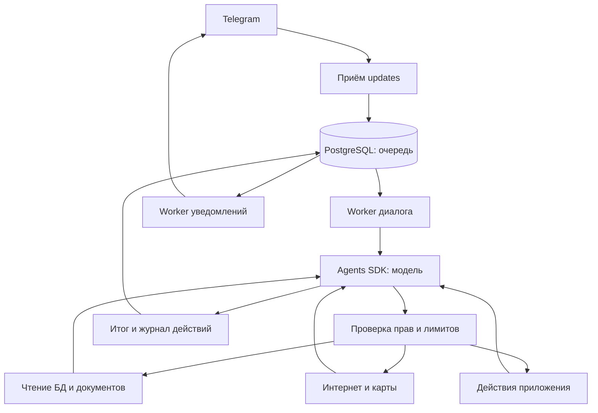

# Архитектура агента

## Состав решения

Приложение — модульный Django-монолит с несколькими процессами и общей PostgreSQL. Telegram остаётся единственным пользовательским интерфейсом. Модель работает через API; GPU и локальная модель на VPS не нужны.

Многошаговый harness построен на **OpenAI Agents SDK** (`openai-agents`). В установленном пакете 0.24.0 указана лицензия MIT. SDK выполняет цикл вызовов модели и инструментов внутри нашего Python-процесса; права, хранение данных и правила приложения определяет код проекта. Модель и внешние API подключаются отдельно и имеют собственные условия и стоимость.

`bot` принимает updates и сохраняет их до подтверждения получения Telegram. `worker_chat` обрабатывает диалоги. `worker_service` выполняет фоновые операции, повторы и Google-синхронизацию. `worker_notifications` отправляет ответы и напоминания. `scheduler` создаёт задания по расписанию. Опциональные Gunicorn/Caddy обслуживают OAuth callback и служебные HTTP endpoints, без пользовательского веб-интерфейса.

## Цикл одного запроса

1. Бот определяет пользователя, чат и доступные данные. Текст либо расшифрованное голосовое сообщение становится задачей агента. Вложение сначала сохраняется вместе с подписью, затем запускается его распознавание и агентский разбор.
2. `Agent` получает инструкцию, текущую дату/часовой пояс, ограниченный контекст диалога и каталог типизированных инструментов.
3. `Runner` вызывает модель. Она выбирает нужный инструмент и аргументы.
4. Приложение проверяет схему, права и лимиты. Инструмент возвращает данные или понятную ошибку.
5. Результат возвращается модели: она может уточнить поиск, прочитать найденный документ, запросить карту или выполнить разрешённое действие.
6. Цикл заканчивается итоговым ответом, необходимым уточнением пользователя или достижением лимита. Изменения и незавершённые шаги отражаются в результате.

Это агент на время запроса. Он не запускает произвольные новые цели в фоне. Напоминания, повторения, дневной план и Google-синхронизация по-прежнему работают отдельным детерминированным кодом и не требуют доступной LLM.

## Память чата и кэш модели

В PostgreSQL записи истории привязаны к паре «пользователь и Telegram-чат». При чтении общего чата записи разрешённых супругов объединяются по ID сообщения Telegram: модель получает единый разговор с именем и ID каждого автора. Личные чаты остаются раздельными. По умолчанию в запрос входят текущее сообщение, до 49 предыдущих реплик и ответы бота. Расшифрованный голос учитывается как текст, команды Telegram исключаются. `AGENT_HISTORY_USER_LIMIT` принимает любое положительное целое число; итоговый контекст дополнительно ограничивается бюджетом токенов. Старые реплики без ответа бота остаются доступными только в личной истории; в группу они не импортируются.

Перед включением истории в запрос приложение проверяет права на упомянутые в ответе объекты. Если пользователь утратил доступ к источнику, соответствующий обмен пропускается. Ссылки на источники использованной истории сопровождают новый ответ, чтобы его также можно было проверить перед отправкой.

При прямом подключении к поддерживаемым моделям OpenAI, включая GPT-6 Luna и GPT-6.1 Terra, одинаковые инструкции и каталог инструментов образуют общую начальную часть запросов. Каждому диалогу соответствует стабильный ключ кэша. OpenAI может повторно использовать вычисленные состояния этой части запроса. `LLM_PROMPT_CACHE_TTL` задаёт срок кэширования (по умолчанию `30m`, также доступно `12h`). Вызовы Responses API используют `store=False`, а историю следующего запроса бот формирует из PostgreSQL. Использование кэша измеряется полем `cached_input_tokens` в `AgentRun.usage`. Нулевое значение возможно при первом запросе или отсутствии подходящего сохранённого префикса. [Документация OpenAI по кэшированию](https://developers.openai.com/api/docs/guides/prompt-caching).

## Инструменты

Схемы инструментов должны соответствовать подмножеству JSON Schema, поддерживаемому API. Для ссылки на созвон используется отдельное описание строки, поскольку стандартный `HttpUrl` выдаёт неподдерживаемый `format: uri`; проверка URL на стороне приложения сохранена. Тесты отдельно проверяют форматы во всём каталоге и фактическом запросе SDK, а не только валидность обычного JSON Schema.

| Группа | Возможности | Граница доступа |
|---|---|---|
| Записи БД | Поиск и чтение событий, задач, проектов и поездок с фильтрами и постраничной выдачей | Разрешённые модели и поля через Django ORM; произвольного SQL нет |
| Документы | Поиск по извлечённому тексту, чтение фрагментов оригинала, ссылки на документ и позицию | Только документы, доступные пользователю; общий родитель не открывает личный файл |
| Расписание | Поиск свободных окон, построение и принятие дневного плана | Учитываются участники, занятость и ограничения; перед записью выполняется повторная проверка |
| Интернет | Поиск и чтение публичных страниц, ссылки на источники и время получения | Ограниченный HTTP-контент, без браузерной сессии и входа на сайты |
| Карты | Поиск мест, расчёт маршрута и времени пути | Google Places API (New) и Routes API после настройки ключа |
| Действия | Создание и изменение объектов, завершение дел, чек-листы и операции поездок | Прикладные сервисы проверяют права, версии и правила согласования |
| Билеты | Получение сохранённого оригинала | Выдача через Telegram в разрешённый чат |

Инструменты БД выполняют актуальные запросы по мере необходимости. Поиск документов лексический: векторного индекса и embeddings нет. Поддержано чтение текстового слоя PDF и текстовых файлов TXT/MD/CSV/JSON; для изображений используются ранее распознанные сведения. Локальный предел — 200 страниц PDF и 1 млн символов документа, до 16 тыс. символов за один фрагмент; выдача содержит признак усечения и следующую позицию. Скан без текстового слоя требует настроенного распознавания; отсутствие распознанных данных не заменяется догадками модели.

Веб-чтение принимает HTML, обычный текст и PDF до 1 МиБ; возвращает до 20 тыс. символов и до первых 20 страниц внешнего PDF. Поиск в интернете выдаёт до 10 результатов. Google Maps поддерживает автомобиль, пеший путь, велосипед и общественный транспорт в пределах покрытия; для автомобиля запрашивается оценка с учётом трафика. Регистрация, получение багажа и другие пользовательские запасы добавляются отдельно.

Внешние источники возвращаются как недоверенные данные. Текст страницы или документа не выдаёт дополнительных прав, не меняет владельца записи и не расширяет набор инструментов. У агента нет shell, доступа к произвольным файлам сервера или произвольных операций от имени Google-пользователя.

Доступно 32 function tools:

- БД и документы: `search_records`, `read_record`, `search_documents`, `read_document`.
- Адресная книга: `search_addressbook`, `read_addressbook`, `save_place`, `save_contact`, `set_place_alias`, `route_places`.
- Интернет и карты: `search_web`, `read_webpage`, `search_places`, `route_between`.
- Проекты и дела: `create_project`, `create_task`, `update_task`, `convert_task_to_event`, `complete_task`.
- События и планирование: `create_event`, `update_event`, `available_slots`, `plan_day`, `accept_daily_plan`, `configure_recurrence`.
- Поездки: `create_trip`, `add_trip_segment`, `check_trip`.
- Чек-листы и билеты: `make_checklist`, `set_checklist_item`, `link_document`, `send_document`.

## Автономность и согласование

Входящее вложение запускает обычный агентский цикл после сохранения оригинала. Приложение передаёт ID файла и сведения о пересылке; содержимое агент читает инструментами как недоверенные данные. При явном поручении либо однозначном билете с достаточными сведениями агент может создать событие. Сначала он проверяет существующие записи и связи документа, чтобы использовать подходящее событие вместо дубля. Неясные даты, участники, намерение посетить афишу или противоречивые источники требуют уточнения. Альбомы сохраняются по частям и не запускают автоматическое создание до дальнейшего уточнения. Прямая команда `/attach` сохраняет прежний сценарий привязки без новой задачи агенту.

ID сохранённого файла фиксируется в `IncomingUpdate` в той же транзакции, что и запись документа. Распознавание и вызовы модели выполняются после её завершения. При повторной обработке используются этот файл и тот же `update_id` запуска; завершённый ответ возвращается из журнала, а прерванный запуск не воспроизводит уже совершённые действия. Ошибка распознавания или агента не удаляет оригинал. Сценарии и ограничения описаны в [ATTACHMENTS.md](ATTACHMENTS.md).

В настроенном общем чате права проверяются по реальному отправителю: доступны его личные и общие записи, включая документы, адресную книгу и личный план. Переписка хранится отдельно по отправителю и чату. Ответы и выдаваемые оригиналы видны всей группе; это не меняет `visibility` объектов и не позволяет другому участнику читать личные записи владельца своими запросами. Проверка при отправке по очереди и при нажатии на кнопку использует актуальные права соответствующего пользователя. Серверный персональный контекст всё ещё включается в группе отдельно через `PERSONAL_CONTEXT_IN_GROUPS`.

`AGENT_AUTONOMY=personal` — режим по умолчанию. Агент может выполнить разрешённые операции, связанные с запросом, без подтверждения каждого промежуточного шага. Общие задачи, события и поездки доступны для редактирования обоим разрешённым супругам независимо от автора, включая уже сохранённые записи и их чек-листы. В карточке `read_record` поле `can_edit` показывает актуальное право, а каждый изменяющий инструмент повторно проверяет его. Права проектов и документов остаются отдельными; общий доступ к задаче не расширяет доступ к её личным вложениям.

Запрос Бориса или Анны «добавь событие на двоих» создаёт общее событие со статусом `confirmed` и двумя участниками. Событие с `blocks_time=true` сразу занимает время у обоих. Информационная дата с `blocks_time=false` видна в расписании, но не резервирует время. Второй участник получает информационное сообщение в подключённом личном чате. Редактирование описания, адреса, ссылки, перенос и отмена ранее созданного общего события выполняются сразу по поручению любого разрешённого супруга, без согласования второго. Сервис повторно проверяет права и актуальную версию, записывает аудит и обновляет напоминания и синхронизацию Google. Для события, которое автор ставит только другому человеку, требуется согласие этого человека.

`read_only` запрещает агенту изменения задач, событий и других предметных записей. Разрешены чтение, поиск, расчёт с сохранением черновика дневного плана и выдача доступного оригинала документа в тот же чат, из которого пришёл запрос. Принятие плана с созданием блоков расписания блокируется. Явные команды пользователя остаются отдельным способом управления ботом. Профиль конкретного пользователя переопределяет серверный режим: `/agent autonomy personal` или `/agent autonomy read_only` в личном чате.

Покупки, платежи, бронирование и рассылка произвольным третьим лицам не реализованы. Изменения, внесённые непосредственно в Google Calendar, импортируются без дополнительного подтверждения. Прежние ожидающие правки не применяются при обновлении кода: пользователь повторяет нужное поручение, а агент читает текущую версию и сохраняет изменение. Старое предложение после смены версии события не может его перезаписать.

## Задачи, даты и занятость

`update_task` принимает ID, наблюдаемую версию и изменяемые поля задачи. `convert_task_to_event` в одной транзакции создаёт событие и отменяет исходную ошибочную задачу, сохраняя её для истории и связи. До преобразования агент читает исходную запись и проверяет существующие события; повторная операция с устаревшей версией не создаёт ещё один экземпляр. Владелец и видимость исходной задачи сохраняются, доступные вложения получают связь с событием без изменения собственных прав. Отдельная задача подготовки или покупки подарка не затрагивается. Действующая серия задач и незавершённые зависимости требуют предварительного разрешения пользователем.

`create_event` и `update_event` поддерживают `all_day`, `start_date`, `end_date` и `blocks_time`. Для события на дату нужны `all_day=true` и `start_date`, без `starts_at`/`ends_at`; исключающая конечная дата по умолчанию — следующий день. Новая запись на дату по умолчанию не блокирует время, новая запись с часами блокирует. Для существующих событий при миграции занятость сохраняется. Ежегодные повторы дат строит обычный механизм повторений.

Свободные окна, конфликты и нагрузка учитывают только `blocks_time=true`; информационные даты остаются в отображаемом плане. Если задача без срока или с будущим сроком не размещена в выбранном дне, она учитывается среди отложенных дел. Просроченный срок или срок в этот день требует внимания. Многодневные события показывают диапазон дат. Напоминание новой записи на дату по умолчанию — 09:00 первого дня в её часовом поясе; явно заданные интервалы отсчитываются от начала первого дня. Google импортирует/экспортирует занятость через `transparency`, независимо от наличия часов.

## Надёжность и журнал

Запуск и результаты инструментов сохраняются в PostgreSQL (`AgentRun`, `AgentToolCall`). Они нужны для диагностики и учёта выполненных действий; скрытая цепочка рассуждений модели не сохраняется как отдельный артефакт.

Запись предметных данных и квитанция выполненного действия сохраняются одной транзакцией. Повторный вызов того же действия в рамках запуска использует сохранённый результат, чтобы не создавать дубликаты. Обычные ошибки инструмента возвращаются модели: она может выбрать другой запрос или сообщить, каких данных не хватает.

При исчерпании порции `AGENT_MAX_TURNS` приложение продолжает работу по полному публичному протоколу SDK, включая результаты выполненных инструментов. При временном отказе модели повторяется её последний запрос с уже полученными результатами. Число продолжений ограничивает `AGENT_MAX_CONTINUATIONS`; общий срок, токены и квоты инструментов не сбрасываются. Протокол с незавершённой парой вызов/результат автоматически не продолжается.

После аварийного прерывания процесса сохранённые действия не откатываются и не выполняются заново вслепую. Приложение возвращает частичный результат и предлагает продолжить отдельным запросом. Сохранённый checkpoint — журнал прогресса, а не обещание точного продолжения внутреннего состояния модели.

Перед отправкой ответа повторно проверяется доступ к его источникам. Если доступ к упомянутому документу или записи отозван во время работы, старый текст не должен отправляться получателю. Доставка через Telegram остаётся внешней операцией: при неопределённом сетевом результате повтор сообщения технически возможен.

SDK tracing во внешний сервис отключён. Локальный журнал может содержать личные запросы и результаты инструментов; он хранится вместе с данными приложения и входит в резервную копию. Содержимое, необходимое модели для ответа, передаётся настроенному LLM API.

## Лимиты и стоимость

По умолчанию одна порция выполнения допускает 12 обращений к основной модели и до двух автоматических продолжений. На весь запуск, включая продолжения, действуют ограничения: 24 вызова инструментов, 8 внешних инструментов и 180 секунд работы. Отдельный запрос модели имеет настраиваемый тайм-аут `AGENT_MODEL_TIMEOUT_SECONDS=90` и до `AGENT_MODEL_RETRIES=2` повторов средствами SDK. Уже начатая операция может завершиться после этого времени. Предел вывода одного модельного ответа составляет 2000 токенов, а бюджет всего запуска составляет 80000 входных и выходных токенов. Перед очередным обращением агент оценивает размер входа и ограничивает вывод оставшимся бюджетом. Вход включает историю, системную инструкцию и схемы инструментов. `cached_input_tokens` входит во входные токены и повторно к общему числу не прибавляется.

Бюджеты основного цикла задаются через `AGENT_*` в `.env` и проверяются настройками Django при запуске. Значения по умолчанию применяются, если оператор не указал переменную. Встроенный веб-поиск и структурированное извлечение данных используют отдельные пределы вывода `LLM_WEB_SEARCH_MAX_OUTPUT_TOKENS` и `LLM_STRUCTURED_MAX_OUTPUT_TOKENS`. Карты и поиск тарифицируются по правилам провайдеров. При частичном выполнении агент сообщает о сохранённых действиях и причине остановки.

PDF разбирается отдельным процессом с ограничениями: до 8 секунд, 512 МиБ памяти и 5–6 секунд CPU на Linux. Оригинал сохраняется даже при ошибке извлечения. Внешние запросы дополнительно проверяются на известные ключи API, распознанные реквизиты бронирования/паспортов и длинные буквальные фрагменты прочитанного документа. Эта проверка дополняет инструкции агента, но не является универсальным распознаванием всех чувствительных данных и способов их кодирования.

## Основные библиотеки

| Библиотека | Назначение |
|---|---|
| `openai-agents` / `openai` | Агентский цикл, function tools, вызовы модели |
| `aiogram` | Telegram и загрузка оригиналов файлов |
| `Django`, `psycopg` | Модели, миграции, права и транзакции PostgreSQL |
| `Pydantic` | Типы и проверка аргументов инструментов |
| `httpx` | API поиска, карт, Calendar и получение HTTP-данных |
| `pypdf` | Чтение текстового слоя PDF |
| `python-dateutil` | Повторения и календарные интервалы |
| `cryptography` | Шифрование OAuth-токенов Google |

## Ограничения черновика

Реальные API и Docker-развёртывание требуют проверки на VPS с вашими ключами; локальные тесты используют подменённые ответы провайдеров. Инструмент чтения страниц не выполняет JavaScript и не обходит авторизацию или платный доступ. Карты зависят от покрытия провайдера. Фактические задержки рейсов, покупка билетов и глобальная оптимизация недели остаются за пределами этой версии.

Официальные материалы: [Agents SDK](https://developers.openai.com/api/docs/guides/agents/sdk), [Python SDK и лицензия](https://github.com/openai/openai-agents-python), [Places API](https://developers.google.com/maps/documentation/places/web-service/overview), [Routes API](https://developers.google.com/maps/documentation/routes/overview).

## Адреса и контекст семьи

`Place` и `Contact` — отдельные предметные записи PostgreSQL с обычными ACL и версиями. `PlaceAlias` относится к конкретному пользователю. Контакты не являются `Person` и не авторизуют Telegram ID. Поиск возвращает все подходящие варианты; неоднозначность не разрешается выбором первого совпадения. Ссылки на источники проверяются повторно перед отправкой и использованием истории диалога.

Событие содержит `place_id` и неизменяемый при переезде `place_snapshot`; этап поездки содержит такие же ссылки/снимки отправления и прибытия. Изменение карточки не переносит существующие встречи автоматически. При выборе нового места повторно проверяются доступ и версия карточки. В расчёт пути уходят координаты или подтверждённый адрес, без контактов и заметок о проходе. Чтение карточки не определяет текущее местоположение пользователя.

`assistant.personal_context.build_instructions` дополняет основные инструкции текстом из `private/personal_context.md` перед каждым запуском основного и legacy-ассистента. Пустой файл допустим. Профиль включён в бюджет входного контекста основного агента; в общем чате выключен по умолчанию. Файл поддерживается на сервере, исключён из Git и build context и подключён read-only. См. `PERSONAL_CONTEXT.md`.
